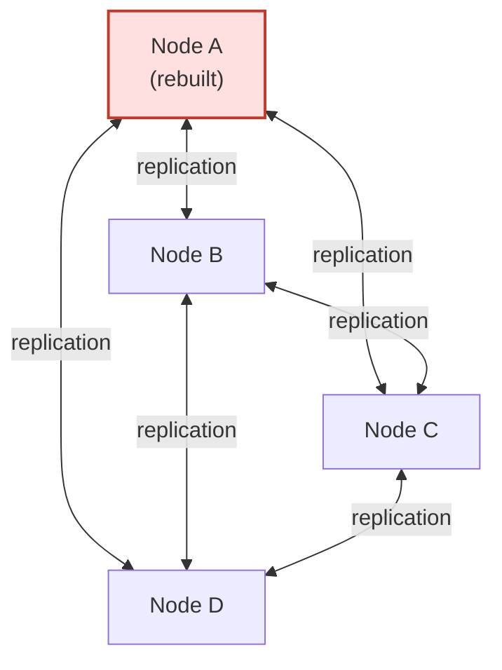

# Rebuilding a PingDirectory Node: Replication Came Back, the Config Didn't

A case study from real IAM operations work: recovering one node of a four-node PingDirectory 10.3 replication topology, and then finding out that "replication is healthy" didn't mean the node was actually back.

All names, hostnames, DNs and paths in this repo are anonymized. Command examples are sanitized or marked as illustrative.

---

## Summary

One server in a four-node PingDirectory 10.3 replication topology had to be rebuilt from scratch. Getting it back into the topology meant working through an encryption-settings mismatch, re-enabling the `userRoot` backend, re-running `dsreplication enable` and `dsreplication initialize`, and getting the server out of lockdown mode.

Once replication was confirmed healthy, I found a second problem. The rebuilt node held the same data as its peers, but it didn't behave the same. Password policy attributes that worked on the other nodes were missing on the rebuilt one, and a test user was being assigned the wrong password policy.

The cause was local server configuration, and replication never carries that. This repo covers both parts. The second part is the one I learned the most from.

---

## Environment

- PingDirectory 10.3
- Four servers. Each one replicated with the other three.
- One `userRoot` backend, around 110k entries
- Custom password policies assigned through virtual attributes instead of being stored on each user entry
- **[VERIFY]** What used the directory (PingFederate, applications, etc.) and whether this was a production or non-production tier. Don't call it production unless it was.

*Simplified, illustrative topology. Not a copy of the real network layout.*

Mermaid source (edit or redraw from this)

---

## What happened, in short

1. **Node A had to be rebuilt.** **[VERIFY: why, what the first symptom was, and who or what noticed it.]**
2. **Getting it back into replication** took four things: fixing an encryption-settings mismatch, re-enabling `userRoot`, running `dsreplication enable` + `initialize` from a healthy peer, and clearing lockdown mode.
3. **Replication checks passed.** 3 peers, 3 in / 3 out connections, backlog 0, 110,885 entries, 0 failed replication operations.
4. **But Node A behaved differently.** The same LDAP query against the same test user gave different answers on Node A and Node B.
5. **Cause: config drift.** A virtual attribute and a plugin were disabled on the rebuilt node, and three custom virtual attributes that assign password policies were missing. Replication copies data, not server configuration, so none of this came back with `initialize`.
6. **Fix:** targeted `dsconfig` changes to match the healthy peer, validated one at a time. Then a planned config-parity pass in small groups instead of applying the full config diff.

---

## Read the details

| Doc | What's in it |
|---|---|
| [Investigation](docs/investigation.md) | Symptoms, what I checked, the encryption-settings mismatch, and how I tracked down the config drift |
| [Recovery and validation](docs/recovery-and-validation.md) | The recovery steps in order, why the order mattered, how replication health was confirmed, and the config-parity plan |
| [Lessons learned](docs/lessons-learned.md) | What I'd do differently next time |

---

## Key takeaway

A node with correct data and the wrong configuration passes every replication check. When I bring a directory server back now, "recovered" means two things: the data matches, **and** the server behaves the same as its peers.

---

*Command examples in this repo are either sanitized versions of commands I ran (hostnames, DNs and paths replaced) or clearly marked as illustrative. Check exact syntax against the documentation for your PingDirectory version.*
